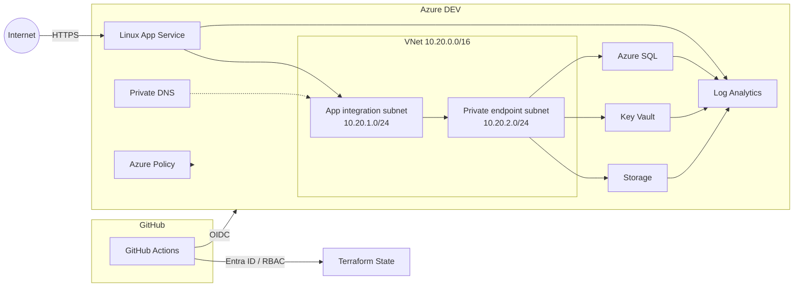

# Enterprise Azure Security Platform

Azure security engineering project built with Terraform.

The environment is intentionally small and disposable, but uses the same patterns I would expect in a real Azure workload: separate identities, private access to data services, policy guardrails, remote Terraform state, CI security checks and centralized logging.

## Architecture



The App Service remains publicly reachable in DEV so the environment can be tested externally.

Storage, Key Vault and Azure SQL are not publicly reachable. The application accesses them through VNet Integration, Private Endpoints and Private DNS.

## What is implemented

### Identity

GitHub Actions authenticates to Azure with OIDC instead of a client secret.

The CI identity has:

- `Contributor` on the DEV resource group
- `Storage Blob Data Contributor` on the Terraform state container

The application has its own user-assigned managed identity.

Its permissions are limited to what the application needs:

- Storage Blob access at container scope
- Key Vault secret reads
- `SELECT` and `INSERT` on the application SQL table

Azure SQL is configured for Entra-only authentication.

I also tested the permission boundaries instead of only checking the Terraform configuration:

- Storage container enumeration → denied
- Key Vault secret write → denied
- SQL `DELETE` → denied

## Private data path

Storage, Key Vault and Azure SQL use Private Endpoints.

The DEV VNet contains two subnets:

```text
10.20.1.0/24  App Service VNet Integration
10.20.2.0/24  Private Endpoints
```

Private DNS zones are used for:

```text
privatelink.blob.core.windows.net
privatelink.vaultcore.azure.net
privatelink.database.windows.net
```

Public network access is disabled on all three data services.

I also tested the DNS dependency by temporarily removing a Private DNS VNet link. The Private Endpoint stayed healthy, but the application resolved the service to its public endpoint and lost the intended private path. Restoring the DNS link restored connectivity.

More detail: [Network Architecture](docs/network-architecture.md)

## Azure Policy

The DEV resource group has policy assignments for:

- required `environment` tag
- Storage public network access disabled
- Key Vault public network access disabled
- App Service HTTPS-only

The tag policy was tested with a deliberately non-compliant deployment. Azure rejected it, and the deployment succeeded after the required tag was added.

## Terraform

The infrastructure is split into three roots:

```text
terraform/
├── bootstrap/          # remote state infrastructure
├── platform/           # GitHub CI identity and deployment boundary
└── environments/
    └── dev/            # application environment
```

Terraform state is stored in Azure Blob Storage.

The backend uses:

- Entra ID authentication
- Azure RBAC
- Shared Key disabled
- anonymous Blob access disabled
- TLS 1.2+
- Blob versioning and retention

The backend still has a public network endpoint because the project uses GitHub-hosted runners. Access to the state itself is controlled through Entra ID and RBAC.

## CI/CD

Pull requests run:

```text
terraform fmt -check
terraform validate
TFLint
Checkov
```

Checkov is pinned to a specific version in the workflow.

Pushes to `main` also run an authenticated Terraform plan through GitHub OIDC.

DEV apply is manual through `workflow_dispatch`.

I tested the security gate with an intentionally insecure NSG rule allowing SSH from the Internet.

Terraform validation passed, but Checkov failed the pull request with:

```text
CKV_AZURE_10
Ensure that SSH access is restricted from the internet
```

After removing the rule, the pipeline returned to green.

Checkov suppressions that remain in the Terraform code have comments explaining why the control is either not applicable or intentionally different in this DEV environment.

## Logging and detection

Security-relevant logs are sent to Log Analytics.

| Source | Logs |
|---|---|
| Azure Activity Log | Administrative, Security and Policy events |
| Key Vault | Audit events |
| Azure SQL | Security audit events |
| Storage Blob | Read, write and delete operations |
| App Service | HTTP logs |

Current KQL detections:

- denied Key Vault secret writes
- Azure RBAC assignment changes

The Key Vault query was tested by attempting a forbidden `SecretSet` operation with the application identity and confirming the resulting `403` in Log Analytics.

Queries are in [`detections/kql`](detections/kql/).

I did not deploy Microsoft Sentinel for this project. The current scope is Azure security engineering and telemetry rather than building a full SIEM environment.

## DEV vs production

Some controls are intentionally reduced in DEV to keep the environment cheap and easy to rebuild.

| DEV | Production |
|---|---|
| Public App Service endpoint | Restricted or WAF-controlled ingress |
| B1 App Service | Redundant production tier |
| Basic Azure SQL | HA-capable production tier |
| Storage LRS | Redundancy based on workload requirements |
| Key Vault purge protection disabled | Purge protection enabled |
| 30-day Log Analytics retention | Longer retention / archive |
| No Sentinel | SIEM integration where required |

These differences are intentional and documented in the Terraform configuration instead of being hidden just to make security scanners pass.

## Repository

```text
.
├── .github/workflows/
├── app/
├── detections/kql/
├── docs/
└── terraform/
    ├── bootstrap/
    ├── platform/
    └── environments/dev/
```

Useful documentation:

- [Security Requirements](docs/security-requirements.md)
- [Threat Model](docs/threat-model/threat-model.md)
- [Identity and CI Authentication](docs/identity-flow.md)
- [Network Architecture](docs/network-architecture.md)
- [Application, Data and Governance](docs/application-data-governance.md)
- [Telemetry and Detection](docs/telemetry-detection.md)
- [Architecture Decision Records](docs/adrs/)
- [Cost and Teardown](docs/cost-and-teardown.md)

## Stack

Azure, Terraform, AzureRM, AzAPI, GitHub Actions, Microsoft Entra ID, OIDC, Managed Identities, Azure RBAC, Private Link, Private DNS, Azure Policy, Log Analytics, KQL, Checkov and TFLint.

---

This is a portfolio environment, not a production system. The goal is to build and test the security controls directly rather than reproduce every production service or availability feature.

## License

[MIT](LICENSE)