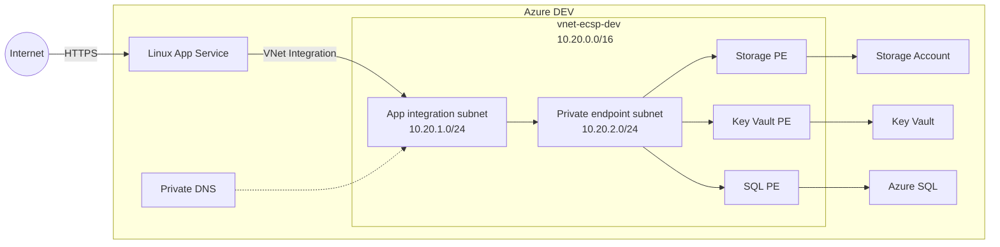

# Network Architecture

The DEV environment keeps the application publicly reachable for testing, while Storage, Key Vault and Azure SQL are reachable only through private Azure networking.

## Architecture



The App Service frontend remains public in DEV. Public network access is disabled on Storage, Key Vault and Azure SQL.

## Network layout

The VNet uses:

```text
10.20.0.0/16
```

with two subnets:

| Subnet | Range | Purpose |
|---|---|---|
| `snet-app-integration` | `10.20.1.0/24` | App Service VNet Integration |
| `snet-private-endpoints` | `10.20.2.0/24` | Private Endpoints |

The application subnet is delegated to:

```text
Microsoft.Web/serverFarms
```

Private Endpoints are kept in a separate subnet so their traffic can be controlled independently.

## Application traffic

The application uses App Service VNet Integration for outbound access.

The intended path to data services is:

```text
App Service
    ↓
App integration subnet
    ↓
Private DNS resolution
    ↓
Private Endpoint
    ↓
Azure PaaS service
```

The application still uses the normal Azure service hostnames. Private DNS changes where those hostnames resolve from inside the VNet.

## Private Endpoints

Private Endpoints are configured for:

- Azure Storage Blob
- Azure Key Vault
- Azure SQL

Public network access is disabled on all three services.

This means application access to the data tier does not depend on the public Azure service endpoints.

## Private DNS

The VNet is linked to:

```text
privatelink.blob.core.windows.net
privatelink.vaultcore.azure.net
privatelink.database.windows.net
```

The application therefore connects using standard service names while DNS resolves them to the corresponding private endpoint addresses.

For example:

```text
stecspappdevjz.blob.core.windows.net
        ↓
stecspappdevjz.privatelink.blob.core.windows.net
        ↓
Private Endpoint IP
```

The same pattern is used for Key Vault and Azure SQL.

## Network Security Groups

Both subnets have dedicated NSGs.

The App Service integration subnet allows traffic toward the Private Endpoint subnet and denies other VNet destinations.

The Private Endpoint subnet allows traffic from the application subnet and denies other VNet-originated traffic.

These controls are intentionally simple because the environment contains a single application path rather than a larger multi-tier network.

## Validation

The private data path was tested from the application environment.

Storage, Key Vault and Azure SQL were successfully accessed through the workload managed identity while public network access remained disabled.

Storage connectivity was also tested from outside the VNet. The public service endpoint remained unreachable because of the Storage network configuration.

### DNS failure test

The Blob Private DNS VNet link was deliberately removed while the Private Endpoint itself remained in place.

The application then resolved the Storage hostname to the public Azure endpoint instead of the private address, breaking the intended data path.

Restoring the VNet link restored private resolution and connectivity.

This test demonstrated that a Private Endpoint alone is not enough; correct DNS configuration is part of the security design.

## DEV boundary

The current environment deliberately keeps App Service ingress public so the application can be tested without deploying a production ingress stack.

A production design would typically add controls such as:

- Application Gateway or another controlled ingress layer
- WAF
- stronger subnet and egress segmentation
- hub-and-spoke networking where appropriate
- centralized firewalling or egress inspection
- production-grade availability

Those components are outside the current lab scope because they are not required to demonstrate the private application-to-data path.
