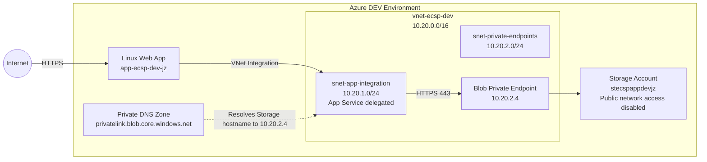

# Network Architecture

The DEV environment uses Azure App Service VNet Integration, Private Endpoints, Private DNS, and subnet-level NSGs to provide private application-to-data connectivity.

The current implementation exposes the web application publicly while keeping access to sensitive PaaS data services on private Azure networking.

## DEV Architecture



## Network Layout

The DEV VNet uses the address space:

```text
10.20.0.0/16
```

It currently contains two dedicated subnets:

| Subnet | Address range | Purpose |
|---|---|---|
| `snet-app-integration` | `10.20.1.0/24` | App Service VNet Integration |
| `snet-private-endpoints` | `10.20.2.0/24` | Private Endpoints for sensitive PaaS services |

The application integration subnet is delegated to:

```text
Microsoft.Web/serverFarms
```

The Private Endpoint subnet is kept separate from the application subnet so network policy and traffic flows can be controlled independently.

## App Service Networking

The Linux Web App is integrated with:

```text
snet-app-integration
```

VNet Integration provides outbound connectivity from App Service into resources reachable through the VNet.

It does not make the application's public frontend private.

The intended DEV traffic model is therefore:

```text
Internet
    |
    v
Public App Service endpoint
    |
    v
App Service
    |
    | outbound through VNet Integration
    v
snet-app-integration
    |
    v
Private Endpoint
    |
    v
Sensitive PaaS service
```

A production deployment would place additional ingress controls such as Application Gateway and WAF in front of the application.

## Private Endpoint

The application Storage Account exposes its Blob service through a Private Endpoint located in:

```text
snet-private-endpoints
```

The Private Endpoint received the address:

```text
10.20.2.4
```

The Storage Account has public network access disabled.

The application therefore reaches the Blob service through:

```text
App Service
    |
    v
snet-app-integration
    |
    v
10.20.2.4
    |
    v
Blob Private Endpoint
    |
    v
Azure Storage
```

## Private DNS

The following Private DNS zone is used for Blob Storage:

```text
privatelink.blob.core.windows.net
```

The zone is linked to `vnet-ecsp-dev`.

The Private Endpoint DNS zone group creates and manages the Storage Account record in the private zone.

From the App Service environment, the standard Storage hostname resolves as:

```text
stecspappdevjz.blob.core.windows.net
    |
    v
stecspappdevjz.privatelink.blob.core.windows.net
    |
    v
10.20.2.4
```

Applications continue to use the normal Azure Storage hostname:

```text
stecspappdevjz.blob.core.windows.net
```

They do not need to explicitly use the `privatelink` hostname.

## Network Security Groups

Separate NSGs are associated with the application integration and Private Endpoint subnets.

The current DEV policy allows application traffic from:

```text
10.20.1.0/24
```

to the Private Endpoint subnet:

```text
10.20.2.0/24
```

while denying unintended traffic between other VNet destinations.

The current rules are intentionally broader than the final application-specific policy because the remaining PaaS services and required application flows will be introduced in later stages.

## Connectivity Validation

Private connectivity was validated from inside the App Service environment.

DNS resolution returned the Private Endpoint:

```text
stecspappdevjz.blob.core.windows.net
→ stecspappdevjz.privatelink.blob.core.windows.net
→ 10.20.2.4
```

HTTPS connectivity then successfully established a connection to:

```text
10.20.2.4:443
```

including a successful TLS handshake with Azure Storage.

This validated the path:

```text
App Service
→ VNet Integration
→ Private DNS
→ Private Endpoint
→ Azure Storage
```

## Public Path Validation

The same Storage hostname was queried from outside the Azure VNet.

It resolved to the public Azure Storage endpoint:

```text
stecspappdevjz.blob.core.windows.net
→ 20.209.95.65
```

A valid authenticated Blob API operation from the external client was rejected by the Storage Account network policy.

This demonstrated that:

```text
Inside VNet
→ private DNS resolution
→ Private Endpoint
→ permitted

Outside VNet
→ public DNS resolution
→ public Storage endpoint
→ blocked by Storage network policy
```

## DNS Failure Test

Private DNS behavior was deliberately broken by removing the Blob Private DNS zone VNet link.

The Private Endpoint itself remained healthy.

After removing the DNS link, the App Service resolved the Storage hostname to the public endpoint:

```text
stecspappdevjz.blob.core.windows.net
→ 20.209.95.65
```

instead of:

```text
10.20.2.4
```

This demonstrated that creating a Private Endpoint alone is not sufficient. Workloads must also have correct DNS resolution for the Private Link path to be used.

Restoring the VNet link restored resolution to:

```text
10.20.2.4
```

and the private path became available again.

## Production Reference

The DEV environment intentionally uses a reduced-cost architecture.

The production reference design extends the same principles with:

- Application Gateway and WAF for controlled application ingress
- hub-and-spoke networking
- centralized Azure Firewall egress control
- multiple subscriptions and management groups
- stronger network segmentation
- Private Endpoints for Storage, Key Vault, and SQL
- centralized monitoring and security telemetry

The DEV environment is designed to validate the same core security patterns without requiring the full production infrastructure.
